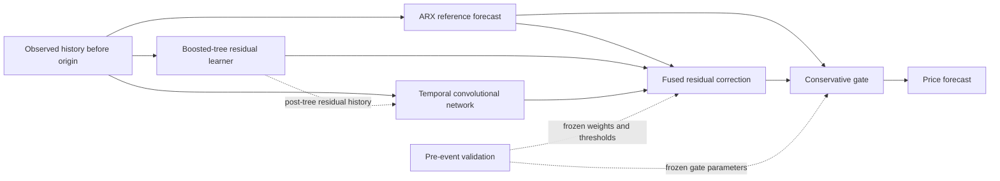

# ⚡ ARX-RPC: Residual-Path Correction for Electricity Price Forecasting

This repository provides a compact, runnable implementation of **ARX-anchored residual-path correction** for short-term electricity spot-price forecasting. It combines an interpretable reference forecast, nonlinear and temporal residual learning, and conservative gating.

## 📰 News

- **2026-10-23:** Minimal implementation with a synthetic example, multi-horizon forecasting, and chronological evaluation.

## 🛠️ Installation and data preparation

Use Python **3.10 or later** with NumPy, pandas, scikit-learn, and PyTorch. CPU execution is sufficient for the example.

```bash
git clone https://github.com/Paladin-art/ARX-RPC.git
cd ARX-RPC
python -m venv .venv
```

Activate the environment with `source .venv/bin/activate` on Linux/macOS or `.venv\Scripts\activate` on Windows, then install:

```bash
python -m pip install -e .
```

Generate the demonstration dataset:

```bash
arx-rpc demo --output data/demo.csv --days 42
```

This generates **synthetic data** at 15-minute resolution. The example demonstrates the forecasting workflow; it does not reproduce the manuscript's numerical results or distribute the provincial market dataset.

### Use your own data

Supply a CSV on a complete, increasing 15-minute grid:

```csv
timestamp,price,load_forecast,wind_forecast,temperature_forecast
2025-01-01 00:00:00,215.3,92.1,30.4,8.2
2025-01-01 00:15:00,218.1,93.7,28.8,8.1
```

Set the file path, feature names, training/validation boundaries, and evaluation windows in `config/demo.json`. Paths are resolved from the working directory. Window ends are exclusive.

The minimal implementation uses **historical prices and historical forecast covariates strictly before each forecast origin**, plus known target-calendar information. It does not consume future realized prices or future covariate rows. Covariates must reflect information genuinely available at their recorded times. Missing covariates are imputed using training-only statistics; observed price history must be complete.

## 🚀 Basic usage

### Train and evaluate

```bash
arx-rpc train --config config/demo.json
```

The default configuration forecasts **96 steps** (24 hours) from **288 historical observations** (three days). It trains the reference and residual models on the training interval, selects the TCN checkpoint, fusion weights, and gate parameters on validation data, and then freezes the fitted model before the evaluation windows.

The entry point reports three variants:

| Variant | Forecast |
| --- | --- |
| `arx` | Autoregressive model with exogenous inputs (ARX) reference |
| `rpc` | ARX plus fused tree and temporal residual corrections |
| `cs_rpc` | Conservatively gated residual correction |

### Forecast with a saved model

```bash
arx-rpc predict --model outputs/demo/model.joblib --data data/demo.csv --origin "2025-02-12 00:00:00" --output outputs/forecast.csv
```

The forecast origin is the **first unobserved timestamp**. Input data may end immediately before that origin; future target prices are not required. Only load checkpoints you created or trust.

### Run the checks

```bash
python -m unittest discover -s tests -v
```

The checks cover future-data isolation, training/validation separation, causal convolutions, convex gating, metric definitions, error identities, and checkpoint round trips.

## 🧩 Model overview



1. **Reference prediction.** A regularized linear ARX model provides the reference forecast.
2. **Dual-path residual learning.** A boosted-tree model learns the ARX residual. A temporal convolutional network (TCN) learns the residual remaining **after tree correction**. Its inputs contain past post-tree residuals and historical covariates, and its output is an entire forecast path.
3. **Conservative gated stabilization.** The gate interpolates between ARX and the full correction. Its prediction-based risk thresholds and interpolation weights are selected on validation data.

The tree learner uses scikit-learn's histogram gradient boosting. The TCN uses causal dilated convolutions with residual connections. Fusion weights minimize validation tail-weighted mean absolute error. Gate selection prioritizes validation absolute peak bias, then tail and average errors.

Overlapping origin-specific forecasts are averaged by target timestamp before gating and evaluation. Parameters stay fixed while newly observed history can become available at later origins.

## 📁 File structure

```text
ARX-RPC/
├── config/
│   └── demo.json          # Chronological splits, model options, fixed windows
├── data/                  # Locally generated or user-supplied CSV files
├── src/arx_rpc/
│   ├── data.py            # Synthetic data and origin-safe features
│   ├── models.py          # Causal TCN and conservative gate
│   ├── pipeline.py        # Training, validation selection and frozen inference
│   ├── metrics.py         # Window metrics and analytical error diagnostics
│   └── cli.py             # Demonstration, training and prediction commands
├── tests/
│   └── test_pipeline.py   # Scientific and end-to-end checks
├── outputs/               # Generated forecasts, metrics and checkpoints
└── pyproject.toml
```

## 📊 Outputs and evaluation

Training writes the following files to the configured output directory:

| File | Contents |
| --- | --- |
| `predictions.csv` | Aggregated ARX, RPC and gated forecasts with gate strengths |
| `origin_predictions.csv` | Individual forecast paths and residual contributions |
| `metrics.csv` | Per-window MAE, RMSE, upper-tail MAE, peak bias and coverage |
| `selection.json` | Frozen fusion/gate settings, split boundaries and training history |
| `error_analysis.csv` | Correction direction, relative magnitude and squared-error changes |
| `model.joblib` | Fitted model for subsequent forecasting |

**Mean absolute error (MAE)** measures overall accuracy. **ExtremeMAE** is calculated on actual prices at or above the window's 90th percentile. **Absolute peak bias (AbsPeakBias)** is the absolute difference between the predicted and observed maximum price. **Coverage** counts missing forecasts against the complete requested window grid.

Tail membership uses observed prices for evaluation only. It is not a prediction-time gate input. Overlapping windows are evaluated separately and need not represent independent events.
